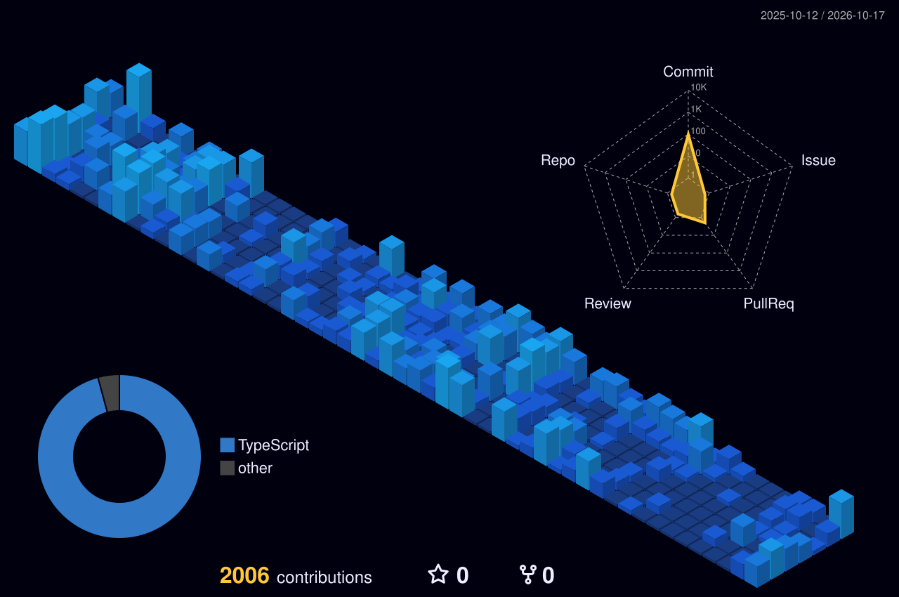

<h1 align="center">Mustafa Serhat Peker</h1>
<h3 align="center">Software Developer • AI Enthusiast • Continuous Learner</h3>

  <a href="mailto:mustafaserhatpeker@gmail.com">mustafaserhatpeker@gmail.com</a>

---

## About Me

- I build software with a focus on clean architecture, maintainable code, and practical results.
- I am currently improving my skills in **TypeScript**, **Rust**, and **AI-driven development**.
- I enjoy solving complex problems and turning ideas into production-ready projects.

---

## Tech Stack

  

---

## GitHub Analytics

  

  

